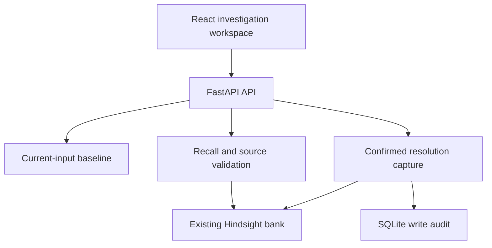

# ReTrace architecture

One FastAPI application owns validation, incident reasoning, Hindsight integration, and a SQLite write audit. React provides a guided investigation flow. A Docker build can serve the compiled frontend from the same FastAPI process; separate static hosting is also supported.

## The reasoning boundary

`baseline(incident)` receives only current input. It has no database or memory client. `enrich(incident, baseline, evidence)` can add historical context only from confirmed source documents that Hindsight recall referenced. It checks service, environment, and meaningful symptom overlap before promoting interventions.

Unverified attempts and inconclusive outcomes remain visible in the source but do not become failed/successful recommendations. Historical root causes remain hypotheses for the current incident. Optional reflection is explicitly requested and displayed separately.

## Capture and retry behavior

The engineer supplies an incident ID, root cause, attempts, and lessons, then confirms the facts. Inputs are redacted before local or remote persistence. A SQLite transaction reserves the immutable ID and payload digest before the external write. A successful synchronous SDK response marks the row retained. A failure or timeout marks it unconfirmed; it is not displayed as a confirmed Hindsight write. Retries use the original stable document ID. Successful unchanged retries skip the SDK write locally; conflicting payloads return 409.

The external API and SQLite are not a distributed transaction. A process crash or timeout can leave the local row uncertain even if Hindsight completed the write. The same document ID avoids duplicate source documents during recovery. If the local database is lost, replay may spend credits reprocessing the same remote document; it will not create a new document ID.

## Failure Ledger and audit

Live intervention details are taken from recalled source documents. The local timeline is a write audit for this deployment, not an inventory of all Hindsight memories. The static sample workspace uses a completely separate browser-local dataset, clearly labeled, with no backend or Hindsight claims.

## Future scale

A production version should isolate memory banks and structured records by authenticated tenant, replace SQLite with a shared transactional store, add distributed quotas, define retention/deletion policies, audit source changes, and evaluate retrieval on unseen incident paraphrases. Ingestion from monitoring and ticket systems should preserve provenance and human confirmation. None of these are implemented as hidden MVP features.
